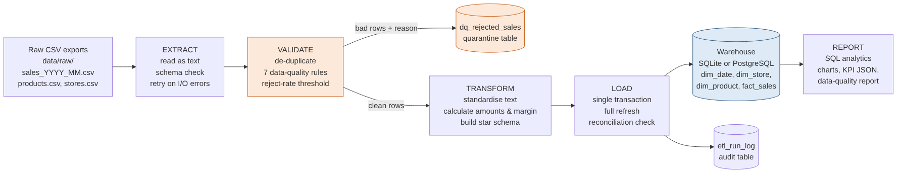
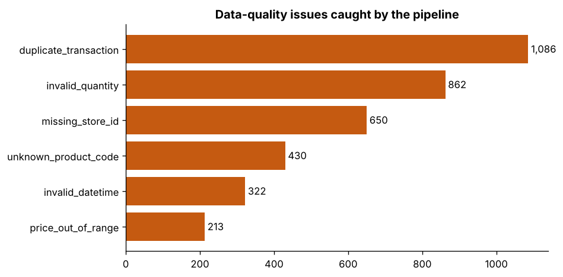
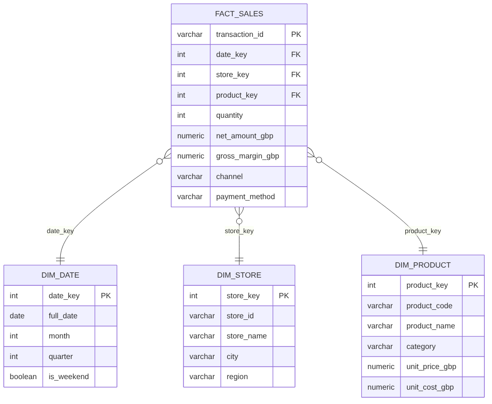

# Retail Sales ETL Pipeline & Data Warehouse

An end-to-end, production-style **ETL pipeline** in Python and SQL. It takes a year of raw
till-system exports from a fictional UK retail chain (12 stores, 60 products, ~110,000 rows),
**validates** them against data-quality rules, **transforms** them into a **star-schema data
warehouse** (SQLite by default, PostgreSQL optional), and produces **analytics**: SQL result tables,
charts, a KPI summary and a data-quality report.

> **Data note:** all data is **synthetic**, created by `retail_etl/generate_data.py`. It deliberately
> includes realistic problems (duplicate scans, missing IDs, impossible dates, negative quantities,
> unknown products, price outliers, messy text) so the pipeline has something real to catch.



---

## Results (latest run)

| Metric | Value |
|---|---|
| Raw rows extracted (12 monthly files) | **110,076** |
| Duplicate transactions removed | **1,086** |
| Rows rejected and quarantined (with reason) | **2,457** (2.23%) |
| Rows loaded to `fact_sales` | **106,533** |
| Reconciliation (DB vs transformed) | **Passed** - rows and £ totals match |
| Net revenue / gross margin | **£6.94m / £2.42m (34.8%)** |
| End-to-end runtime (laptop) | **~5 seconds** |
| Automated tests | **19 passing** (`pytest`) |



More outputs: [`outputs/`](outputs/) (charts, CSV tables, `kpi_summary.json`, `data_quality_report.md`).

---

## What the pipeline does

| Stage | What happens | Code |
|---|---|---|
| **Extract** | Reads every `sales_YYYY_MM.csv` plus product and store reference files. Everything is read as text so one bad value can't crash the run; required columns are checked; file reads retry with exponential backoff. | `extract.py` |
| **Validate** | Removes duplicate transaction IDs, then applies 7 rules (missing/unknown store, unknown product, invalid quantity, invalid datetime, price out of range, invalid discount). Failed rows go to a **quarantine table with the reason**. If more than 10% of rows fail, the run **stops** before loading. | `validate.py` |
| **Transform** | Standardises text, calculates gross/discount/net amounts, cost and margin, and builds a **star schema**: `dim_date`, `dim_store`, `dim_product`, `fact_sales`. | `transform.py` |
| **Load** | Rebuilds the warehouse **inside one transaction** (all-or-nothing, safe to re-run), loads dimensions before facts, then **reconciles** row counts and £ totals. | `load.py`, `sql/schema.sql` |
| **Report** | Runs the SQL in `sql/analytics/`, saves CSVs and charts, writes a KPI JSON and a data-quality report. | `analytics.py` |
| **Audit** | Every run (success or failure) is recorded in `etl_run_log`, and logs go to `logs/pipeline.log`. | `pipeline.py` |



---

## Run it (Windows + VS Code)

```bash
# 1. Open the folder in VS Code, then open a terminal (Ctrl + `)
python -m venv .venv
.venv\Scripts\activate            # macOS/Linux: source .venv/bin/activate

# 2. Install
pip install -r requirements.txt
pip install -e .

# 3. Generate the synthetic raw data and run the whole pipeline
python -m retail_etl all

# 4. Run the tests
pytest
```

Or simply run `scripts\run_pipeline.bat` (Windows) / `scripts/run_pipeline.sh` (macOS/Linux).

Other commands:

```bash
python -m retail_etl generate          # only create raw files in data/raw
python -m retail_etl run               # only run the pipeline on existing raw files
python scripts/query_warehouse.py "SELECT * FROM dim_store"
```

### Use PostgreSQL instead of SQLite (optional)

```bash
docker compose up -d                   # starts PostgreSQL 16 locally
copy .env.example .env                 # then uncomment the PostgreSQL DATABASE_URL line
python -m retail_etl run
```

---

## Project structure

```
retail-sales-etl-pipeline/
├── src/retail_etl/          # the pipeline package
│   ├── __main__.py          # CLI: generate | run | all
│   ├── config.py            # settings from environment / .env
│   ├── generate_data.py     # synthetic raw data with injected quality issues
│   ├── extract.py           # read + schema check + retry
│   ├── validate.py          # de-duplication, 7 DQ rules, reject threshold
│   ├── transform.py         # star schema + amount calculations
│   ├── load.py              # transactional load + reconciliation + run log
│   ├── analytics.py         # SQL reports, charts, KPI + DQ reports
│   ├── pipeline.py          # orchestration and timing
│   ├── logging_setup.py     # console + rotating file logs
│   └── utils.py             # retry decorator, timer
├── sql/
│   ├── schema.sql           # warehouse DDL (SQLite + PostgreSQL compatible)
│   └── analytics/           # 6 reporting queries
├── tests/                   # 19 pytest tests (unit + end-to-end)
├── outputs/                 # results: charts/, tables/, reports/
├── docs/                    # architecture diagrams, presentation, final report
├── data/                    # raw/ and processed/ (generated, git-ignored)
├── scripts/                 # one-click run scripts, warehouse query helper
├── requirements.txt         # dependencies
├── requirements-lock.txt    # exact versions this was tested with
├── pyproject.toml           # package definition + CLI entry point
├── docker-compose.yml       # optional PostgreSQL
├── .env.example             # configuration template
└── PROJECT_SUMMARY.md       # one-page summary
```

## Documentation

- [Project summary](PROJECT_SUMMARY.md)
- [Final report (PDF)](docs/report/Retail_Sales_ETL_Final_Report.pdf)
- [Presentation (PPTX, ~25 minutes with speaker notes)](docs/presentation/Retail_Sales_ETL_Presentation.pptx)

## Tech stack

Python 3.10+, pandas, NumPy, SQLAlchemy 2, SQLite / PostgreSQL, SQL, matplotlib, pytest,
python-dotenv, Git. Docker Compose (optional, for PostgreSQL).

## Possible next steps

- Incremental loads (only new monthly files) with a file-registry table
- Slowly changing dimensions (type 2) for store and product changes
- Orchestration with Airflow or Prefect, and a scheduled daily run
- Data contracts with Great Expectations or pandera
- A Power BI dashboard on top of the warehouse

## Author

Mohamed Moin Peer - MSc Data Analytics, Queen's University Belfast
[LinkedIn](https://linkedin.com/in/moinpeer01)
